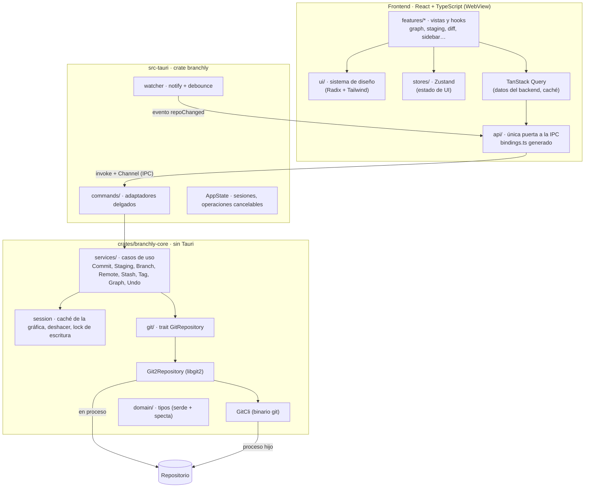

# Arquitectura de Branchly

Este documento explica cómo está organizado Branchly, cómo viaja una acción
desde un clic hasta Git y de vuelta, y por qué se tomaron las decisiones
principales. Las decisiones están detalladas en los [ADR](docs/adr).

## Visión general



### Capas del backend

| Capa | Ubicación | Responsabilidad | No hace |
|---|---|---|---|
| `commands/` | `src-tauri/src/commands` | Recibir argumentos de la IPC, elegir la sesión y delegar en un servicio en un hilo bloqueante | Lógica de Git |
| `services/` | `crates/branchly-core/src/services` | Validar entradas, aplicar reglas de seguridad, orquestar varias llamadas, decidir qué se puede deshacer | Hablar con libgit2 o el CLI directamente |
| `git/` | `crates/branchly-core/src/git` | El trait `GitRepository` y su implementación (libgit2 + adaptador CLI) | Reglas de negocio |
| `domain/` | `crates/branchly-core/src/domain` | Tipos de datos puros que cruzan capas y la IPC | Comportamiento |

`error.rs` define los errores tipados (`thiserror`), cada uno con un
`ErrorCode` estable y un mensaje legible. Se serializan al frontend como
`ErrorPayload { code, message, detail }`.

### Frontend

```
src/
├── api/        Wrappers tipados de cada comando; desenvuelven Result → GitError
├── app/        App, QueryClient, restauración de la sesión
├── features/   Una carpeta por funcionalidad (vista + hooks + acciones)
│   ├── graph/      Gráfica: datos paginados, canvas, búsqueda, menús
│   ├── commit/     Panel de detalle de commit y listas de archivos
│   ├── diff/       Diff unificado y lado a lado, resaltado, navegación
│   ├── history/    Historial de un archivo y blame
│   ├── staging/    Panel de cambios, conflictos y editor de commit
│   ├── sidebar/    Ramas, remotos, stashes y etiquetas
│   ├── branches/   Acciones, menú contextual y arrastrar para fusionar
│   ├── repo/       Layout del repositorio, toolbar, acciones, refresco
│   ├── palette/    Registro de comandos, paleta Ctrl/Cmd+K, atajos globales
│   ├── dialogs/    Diálogos y confirmaciones
│   ├── home/       Pantalla de inicio y apertura de repositorios
│   ├── titlebar/   Barra de título propia y pestañas
│   └── settings/   Ajustes
├── lib/        Utilidades puras (fechas, rutas, atajos, texto)
├── stores/     Estado de UI con Zustand (pestañas, selección, ajustes)
├── styles/     Tokens de diseño, fuentes y estilos globales
└── ui/         Sistema de diseño: botones, inputs, diálogos, menús, toasts…
```

Reglas:

- **Los componentes nunca llaman a `invoke`.** Usan `src/api`; ESLint lo impone.
- **Los datos del backend viven en TanStack Query** y el estado de la UI
  (pestañas, selección, vista central, borradores) en Zustand.
- **Las mutaciones pasan por `runAction` / `runRemote`**
  (`features/repo/actions.ts`): muestran el resultado, ofrecen "Deshacer" y
  refrescan el repositorio.
- **Un único registro de comandos** (`features/palette/commands.tsx`) alimenta
  la paleta y los atajos globales; los tooltips muestran los mismos atajos
  (`lib/shortcuts.ts`).

## Recorrido de una acción: preparar un bloque de un diff

1. **Clic.** En `DiffView`, el botón "Preparar bloque" de un hunk construye un
   `HunkRef` (índice y rangos `@@ -a,b +c,d @@`) y llama a
   `runAction(repoId, () => stagingApi.stageHunk(repoId, path, hunk))`.
2. **API.** `stagingApi.stageHunk` llama a `commands.stageHunk` de
   `bindings.ts`, generado por tauri-specta, que hace el `invoke("stage_hunk",
   …)` y devuelve un `Result`. `unwrap` lo convierte en el valor o en un
   `GitError` tipado.
3. **Comando.** `commands::staging::stage_hunk` obtiene la sesión del
   repositorio y ejecuta en `spawn_blocking`, para no bloquear nunca el hilo
   principal:
   `StagingService::new(ctx).stage_hunk(&path, hunk)`.
4. **Servicio.** Valida la ruta, toma el lock de escritura de la sesión y llama
   a `repo.apply_hunk(path, hunk, HunkAction::Stage)`.
5. **Git.** `Git2Repository` recalcula el diff índice→árbol de trabajo de ese
   archivo y comprueba que el hunk sigue teniendo los mismos rangos (si el
   archivo cambió entretanto responde `STALE_DIFF`). Después aplica solo ese
   hunk al índice con `git_apply` y un filtro de hunks.
6. **Vuelta.** El `Result` viaja por la IPC. `runAction` invalida las consultas
   de `['repo', id]` y TanStack Query vuelve a pedir el estado y el diff
   visibles. Si hubo error, se muestra un toast con el mensaje.
7. **Además**, el watcher detecta la escritura de `.git/index` y emite
   `repoChanged { index: true }`. Ese refresco extra no tiene coste, porque las
   consultas ya están frescas o en curso.

Las operaciones de red siguen el mismo camino con dos diferencias. Reciben un
`Channel<Progress>` por el que el adaptador CLI envía el progreso de
`--progress`, y un id de operación con el que el frontend puede cancelarlas
(`cancel_operation` mata el proceso `git`).

## Concurrencia y estado

- `AppState` guarda las sesiones abiertas (`RepoSession`) indexadas por id, las
  operaciones cancelables en curso y la lista de recientes.
- Cada comando abre un **handle nuevo de libgit2** (es barato y no es `Sync`),
  así siempre se observa el estado actual del disco.
- La sesión conserva lo que vale la pena cachear:
  - la **gráfica** calculada, invalidada por fingerprint de referencias;
  - la **última acción deshacible**;
  - un **lock de escritura** que serializa las mutaciones del índice y de las
    referencias hechas por la app (las lecturas no se bloquean).

## Gráfica de commits

Ver [ADR 0003](docs/adr/0003-grafica-de-commits.md). En resumen, el layout de
carriles se calcula en Rust en una sola pasada y se cachea. El frontend pide
páginas de 200 filas para la ventana visible y dibuja solo esa ventana en un
canvas.

## Errores

| Código | Ejemplo | Comportamiento en la UI |
|---|---|---|
| `WOULD_OVERWRITE_CHANGES` | checkout con cambios locales en conflicto | Toast con "Stash y cambiar" |
| `BRANCH_NOT_MERGED` | eliminar una rama sin fusionar | Segunda confirmación, que indica lo que se pierde |
| `STALE_DIFF` / `STALE_GRAPH` | la vista quedó desactualizada | Se refresca la vista |
| `IDENTITY_MISSING` | `user.name` sin configurar | Mensaje con el comando para configurarlo |
| `GIT_COMMAND_FAILED` | push rechazado | Toast con la salida de Git |

## Pruebas

| Dónde | Qué | Cómo |
|---|---|---|
| `crates/branchly-core/src/**` | Algoritmo de carriles, parsing de progreso, validaciones, recientes, clasificación de eventos | Tests unitarios |
| `crates/branchly-core/tests/` | Servicios completos: commits, amend, staging por hunk, ramas, merge con conflicto, stash, etiquetas, deshacer, clone/fetch/pull/push | Repositorios temporales (`tempfile`); remotos bare locales, sin red |
| `src-tauri` | Generación de bindings | `cargo test -p branchly` |
| `src/**/*.test.ts(x)` | Lógica pura (gráfica, diffs, árbol de ramas, atajos, mensajes) y componentes clave (confirmación, editor de commit, toasts, `useHotkey`) | Vitest + Testing Library |
