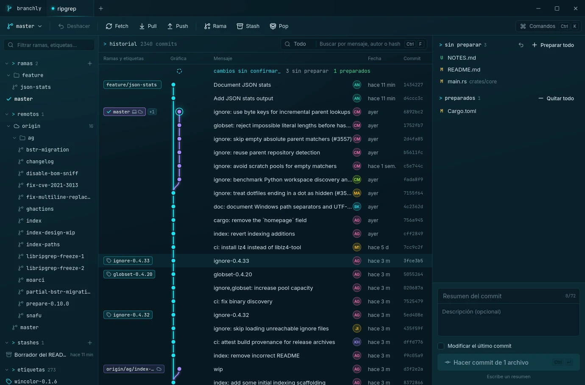
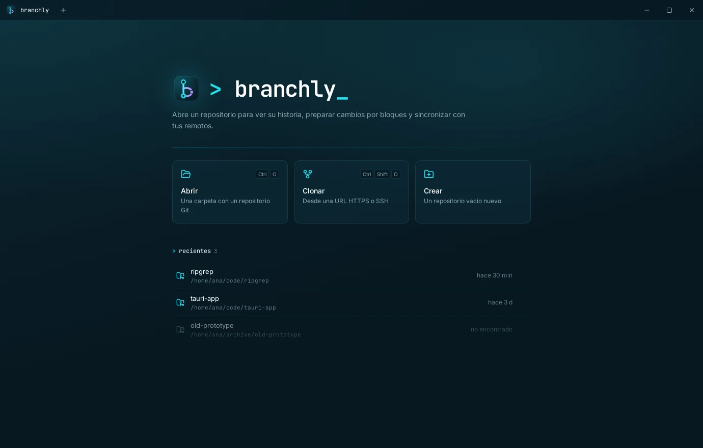
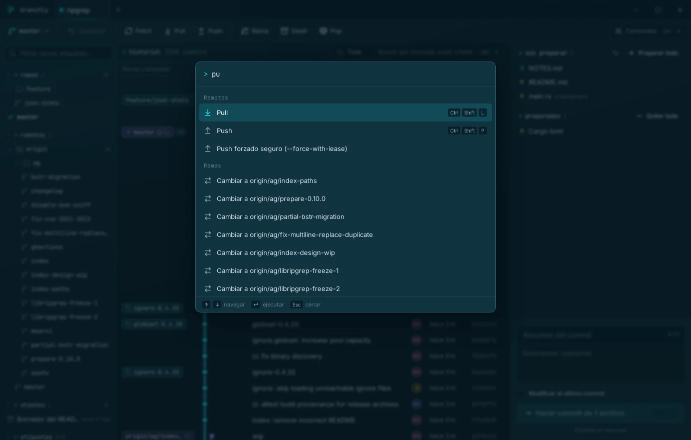
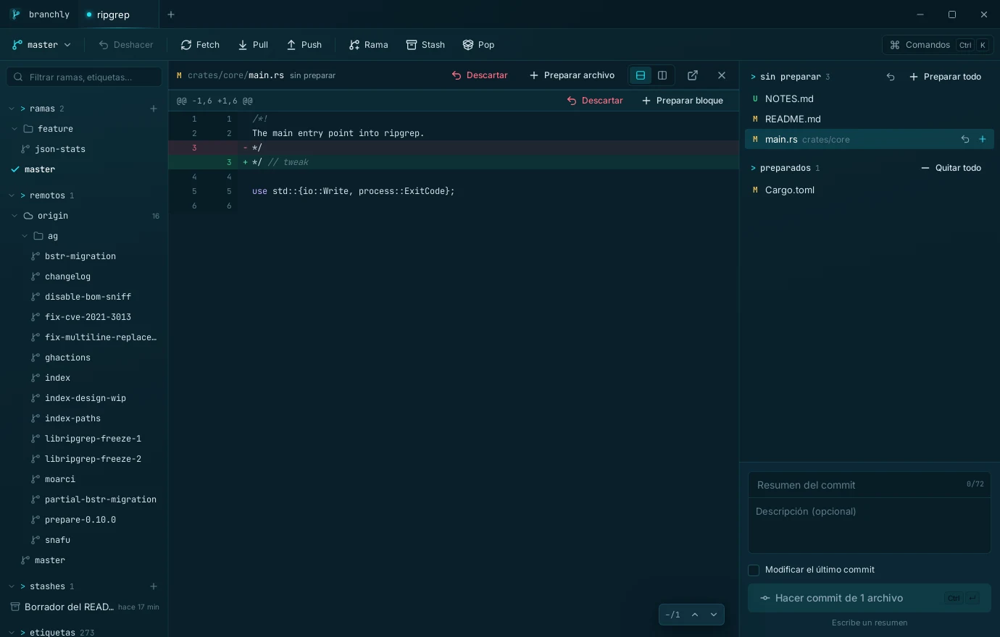
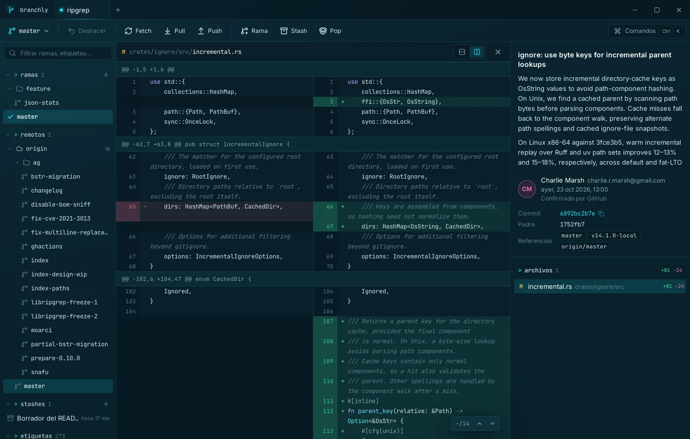

# Branchly

Cliente Git de escritorio ligero y moderno, inspirado en GitKraken. Construido
con Tauri 2 (Rust + WebView del sistema) y React.



> **Software libre y privado.** Branchly se distribuye con licencia
> [MIT](LICENSE-MIT) o [Apache 2.0](LICENSE-APACHE), a tu elección. No recopila
> información ni tiene telemetría, y nunca ve tus credenciales: todo ocurre en
> tu equipo. Los detalles y cómo verificarlo están en
> [docs/PRIVACIDAD.md](docs/PRIVACIDAD.md).

## Funcionalidades

- **Repositorios**: abrir una carpeta, clonar desde una URL con progreso y
  cancelación, crear un repositorio vacío, lista de recientes, pestañas, y
  `branchly <carpeta>` desde la terminal.
- **Gráfica de commits**: carriles de colores por rama, líneas de merge,
  etiquetas de ramas locales, remotas y tags, avatar, mensaje, fecha relativa y
  hash corto. Es fluida con más de 85 000 commits: los carriles se calculan en
  Rust, se dibujan en Canvas y la lista está virtualizada.
- **Historial**: detalle de commit con archivos y diffs, historial de un
  archivo, blame por línea y búsqueda por mensaje, autor o hash.
- **Diffs**: vista unificada y lado a lado, resaltado de sintaxis, números de
  línea y navegación entre cambios.
- **Staging**: preparar y quitar archivos **o bloques (hunks)**, descartar con
  confirmación, editor de commit con resumen y descripción, y amend.
- **Ramas**: crear, cambiar, renombrar, eliminar y fusionar, también
  **arrastrando una rama sobre otra**. Indicadores de commits por delante y por
  detrás del remoto.
- **Remotos**: fetch, pull y push con progreso y notificaciones, y fetch
  automático opcional.
- **Stash** (guardar con mensaje, aplicar, pop, eliminar) y **etiquetas**
  (crear, publicar, eliminar).
- **Conflictos**: detección, lista de archivos, resolver con la versión actual
  o la entrante, abrir en el editor externo, y abortar o continuar.
- **Refresco automático** cuando cambian archivos desde fuera (terminal,
  editor), con debounce.
- **Deshacer** la última operación local cuando es seguro, desde el toast,
  la barra de herramientas o con Ctrl/⌘+Z.
- **Paleta de comandos** (Ctrl/⌘+K), atajos de teclado, menús contextuales y
  navegación completa con teclado.

| | |
|---|---|
|  |  |
|  |  |

## Instalación

Descarga el instalador de tu sistema desde la página de
[Releases](https://github.com/DerianMolinaLopez/Branchly/releases). En todos
los casos necesitas [Git](https://git-scm.com) instalado, porque Branchly usa
tu `git` para clonar, fetch, pull, push y commits.

| Sistema | Archivo | Cómo instalarlo |
|---|---|---|
| **Windows 10 / 11** (64 bits) | `Branchly_x.y.z_x64-setup.exe` | Doble clic. Se instala solo para tu usuario, sin permisos de administrador |
| Windows (empresas, directivas de grupo) | `Branchly_x.y.z_x64_es-ES.msi` | Doble clic, o `msiexec /i` para despliegues |
| Ubuntu, Debian, Mint, Pop!_OS | `Branchly_x.y.z_amd64.deb` | `sudo apt install ./Branchly_*_amd64.deb` |
| Fedora, RHEL, openSUSE | `Branchly-x.y.z-1.x86_64.rpm` | `sudo dnf install ./Branchly-*.x86_64.rpm` |
| Cualquier distribución Linux | `Branchly_x.y.z_amd64.AppImage` | `chmod +x Branchly_*.AppImage && ./Branchly_*.AppImage` |

### Windows

1. Instala [Git for Windows](https://git-scm.com/download/win) y deja la opción
   que lo añade al `PATH`. Incluye Git Credential Manager, que guarda tus
   credenciales para que push y fetch no las pidan cada vez.
2. Ejecuta el `.exe` de Branchly. Microsoft Edge WebView2, que Branchly
   necesita, ya viene con Windows 10 y 11.
3. Los instaladores aún no están firmados, así que SmartScreen puede avisar de
   un editor desconocido: pulsa «Más información» → «Ejecutar de todas
   formas». Puedes comprobar la descarga con `SHA256SUMS-windows.txt`
   (`Get-FileHash <archivo>` en PowerShell).
4. Para desinstalar: «Configuración» → «Aplicaciones».

### Linux

Los ejecutables se prueban en Ubuntu 22.04 y 24.04, Debian 12, Fedora 40, Arch
y openSUSE Tumbleweed. El AppImage puede pedir FUSE 2 (`sudo apt install
libfuse2`). Cómo añadirlo al menú y a la barra de tareas, y los problemas
frecuentes, en [docs/EJECUCION.md](docs/EJECUCION.md).

### Desde la terminal

```bash
branchly                       # pantalla de inicio
branchly ~/code/mi-proyecto    # abre ese repositorio
```

¿Prefieres compilarlo tú? Consulta [Requisitos](#requisitos) y
[Desarrollo](#desarrollo), o [docs/CONSTRUCCION.md](docs/CONSTRUCCION.md) para
generar los instaladores de Linux y Windows.

## Requisitos

| Herramienta | Versión |
|---|---|
| [Git](https://git-scm.com) | 2.30 o superior, en el `PATH` (también en ejecución) |
| [Rust](https://rustup.rs) | 1.88 o superior (`rustup` instala la versión de `rust-toolchain.toml`) |
| [Node.js](https://nodejs.org) | 20 o superior, con npm |

Además, las dependencias de sistema de Tauri:

```bash
# Fedora
sudo dnf install webkit2gtk4.1-devel gtk3-devel libsoup3-devel \
  javascriptcoregtk4.1-devel librsvg2-devel gcc

# Debian / Ubuntu
sudo apt install libwebkit2gtk-4.1-dev libgtk-3-dev libsoup-3.0-dev \
  libjavascriptcoregtk-4.1-dev librsvg2-dev build-essential

# Arch
sudo pacman -S webkit2gtk-4.1 gtk3 libsoup3 librsvg base-devel
```

- **macOS**: Xcode Command Line Tools (`xcode-select --install`).
- **Windows**: Microsoft C++ Build Tools y WebView2 (incluido en Windows 10/11).

Más detalles en los [requisitos de Tauri](https://v2.tauri.app/start/prerequisites/).
No hace falta OpenSSL ni libssh2: las operaciones de red usan tu `git`
([ADR 0002](docs/adr/0002-git2-y-git-cli.md)).

## Desarrollo

```bash
npm install
npm run app:dev                               # app con recarga en caliente
npx tauri dev -- -- /ruta/absoluta/a/un-repo  # y abre ese repositorio al arrancar
```

`npm run app:dev` arranca Vite en el puerto 1420 y compila el backend en modo
debug. En debug, la app regenera `src/api/bindings.ts` (los tipos y comandos
de TypeScript generados desde Rust) al arrancar. También puedes regenerarlos
sin abrir la app:

```bash
npm run bindings
```

### Comprobaciones

```bash
npm run check                       # typecheck, ESLint, Prettier y Vitest
cargo test -p branchly-core         # núcleo: no necesita WebKitGTK
cargo test --workspace              # todo (necesita las dependencias de Tauri)
cargo clippy --workspace --all-targets -- -D warnings
cargo fmt --all --check
```

Las pruebas del núcleo crean repositorios temporales y usan repositorios bare
locales como remotos, así que no necesitan red. La configuración local de
cada repositorio de prueba las aísla de tu configuración global de Git
(identidad, firma, hooks).

## Instaladores

```bash
npm run app:build
```

Genera el binario optimizado (LTO, `codegen-units = 1`, `strip`, `opt-level`
`s` para la app y `3` para el núcleo y libgit2) y los instaladores de la
plataforma actual en `target/release/bundle/`:

| Plataforma | Formatos |
|---|---|
| Linux | `.deb`, `.rpm`, `.AppImage` |
| macOS | `.app`, `.dmg` |
| Windows | `.exe` (NSIS), `.msi`; con `scripts\build-windows.ps1` o ver [docs/CONSTRUCCION.md](docs/CONSTRUCCION.md#windows) |

Para generar solo algunos formatos: `npm run app:build -- --bundles deb,rpm`.
Estos paquetes solo funcionan en tu distribución y versiones más nuevas. Para
ejecutables que funcionen en cualquier distribución, compila en un contenedor
Ubuntu 22.04 con Docker o Podman:

```bash
scripts/build-linux.sh   # AppImage + .deb + .rpm en dist-linux/
```

Los detalles, la tabla de distribuciones probadas y la publicación automática
en GitHub están en [docs/CONSTRUCCION.md](docs/CONSTRUCCION.md).
Los iconos se regeneran desde `src-tauri/icons/logo.svg` con
`npx tauri icon src-tauri/icons/logo.svg -o src-tauri/icons`.

## Rendimiento

Medido en Linux (Fedora 44, build de release):

| Métrica | Resultado |
|---|---|
| Instalador `.deb` / `.rpm` / AppImage | 4,1 MB / 4,1 MB / 79 MB (el AppImage incluye WebKitGTK) |
| Arranque hasta mostrar un repositorio abierto | ≈ 0,4 s |
| Memoria total (app + procesos de WebKitGTK), sin repositorio | ≈ 240 MB, casi todo la base del WebView |
| Memoria con un repositorio de 2 340 commits (ripgrep) | ≈ 300 MB |
| Memoria con `git/git` (85 799 commits) | ≈ 440 MB |
| CPU en reposo | 0–0,5 % |
| Gráfica de `git/git`: cálculo completo | 1,3 s, en segundo plano y solo cuando se mueve una referencia |
| Página de 200 filas / búsqueda en todos los mensajes | 0,7 ms / 7 ms |
| JavaScript inicial | 409 KB (130 KB gzip); diff, blame y paleta se cargan bajo demanda |

## Atajos de teclado

`Mod` es ⌘ en macOS y Ctrl en Linux y Windows. Todos los atajos aparecen
también en los tooltips, los menús y la paleta de comandos.

| Acción | Atajo |
|---|---|
| Paleta de comandos | `Mod+K` |
| Abrir / clonar repositorio | `Mod+O` / `Mod+Shift+O` |
| Fetch / pull / push | `Mod+Shift+F` / `Mod+Shift+L` / `Mod+Shift+P` |
| Nueva rama | `Mod+B` |
| Guardar en el stash / aplicar el último | `Mod+Shift+S` / `Mod+Shift+A` |
| Ir a los cambios / preparar todo | `Mod+Shift+M` / `Mod+Shift+Enter` |
| Hacer commit | `Mod+Enter` |
| Deshacer la última operación | `Mod+Z` |
| Buscar commits | `Mod+F` |
| Cambio siguiente / anterior en un diff | `Alt+↓` / `Alt+↑` |
| Diff unificado / lado a lado | `Mod+Shift+D` |
| Cerrar pestaña / siguiente pestaña | `Mod+W` / `Ctrl+Tab` |
| Navegar commits | `↑` `↓` (o `j` `k`), `Inicio`, `Fin`, `Re Pág`, `Av Pág` |

## Estructura

```
crates/branchly-core/   Núcleo en Rust sin Tauri: domain, git, services, gráfica
src-tauri/              App Tauri: comandos, estado, eventos y watcher
src/                    Frontend React: api, features, ui, stores, styles
docs/adr/               Decisiones de arquitectura
```

- [ARCHITECTURE.md](ARCHITECTURE.md): capas, flujo de una acción y ADR.
- [DESIGN.md](DESIGN.md): tokens, paleta, tipografía y componentes.
- [docs/EJECUCION.md](docs/EJECUCION.md): instalación y uso en Linux.
- [docs/CONSTRUCCION.md](docs/CONSTRUCCION.md): plan para generar ejecutables portables.

## Solución de problemas

- **El push o el fetch fallan pidiendo credenciales**: Branchly no muestra
  prompts. Configura un credential helper (`git config --global
  credential.helper libsecret`, `manager` o `osxkeychain`) o usa SSH con
  `ssh-agent`. Lo que funcione con `git push` en tu terminal funciona en
  Branchly.
- **"Tu identidad de Git no está configurada"**: ejecuta
  `git config --global user.name "Tu nombre"` y
  `git config --global user.email tu@correo`.
- **Los cambios hechos fuera no se refrescan en repositorios enormes**: puede
  agotarse el límite de inotify. Súbelo con
  `sudo sysctl fs.inotify.max_user_watches=524288`.

## Privacidad

Branchly no envía datos a ningún sitio: no hay telemetría, analíticas ni
informes de errores, y el código no incluye ningún cliente HTTP. Las
operaciones de red las hace tu propio `git`, que resuelve las credenciales con
tu *credential helper* o `ssh-agent`; Branchly no las lee ni las guarda. Más en
[docs/PRIVACIDAD.md](docs/PRIVACIDAD.md).

## Licencia

Branchly es software libre. Puedes usarlo, modificarlo y redistribuirlo, también
con fines comerciales, bajo cualquiera de estas dos licencias, a tu elección:

- [Licencia MIT](LICENSE-MIT)
- [Licencia Apache, versión 2.0](LICENSE-APACHE)

Salvo que indiques lo contrario, toda contribución que envíes a este
repositorio se licencia bajo ese mismo doble régimen (MIT o Apache-2.0), sin
términos ni condiciones adicionales.

Las dependencias conservan sus propias licencias; por ejemplo, libgit2 se
distribuye bajo GPL-2.0 con excepción de enlazado, que permite incluirla en
programas con otras licencias.
